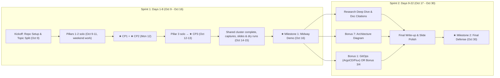
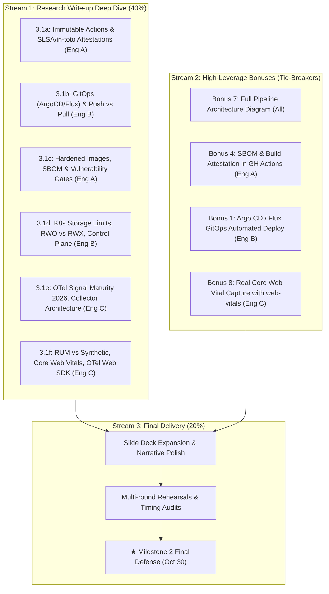

# Project Execution Plan: DevOps & Observability Research (Group B)

**Project:** Assignment 3 — Group B: DevOps & Observability Research  
**Target Audience:** Group B Intern Team (3 Members)  
**Stakeholders:** Thang Le (Track Leader / Primary Stakeholder), Internship Supervisor  
**Execution Window:** Friday, 9 Oct 2026 – Friday, 30 Oct 2026 (~3 Weeks, 22 days)  
**Critical Milestones:**

- **Milestone 1 (Midway Review & Live Demo):** Friday, 16 Oct 2026
- **Milestone 2 (Final Defense & Expanded Demo):** Friday, 30 Oct 2026

---

## 1. Executive Summary & Project Charter

### 1.1 Objectives

1. **Research & Theoretical Mastery (40% of grade):** Deliver an evidence-backed, deeply cited technical findings write-up covering modern CI/CD, supply-chain provenance, GitOps continuous delivery, container hardening, Kubernetes orchestration primitives/storage bounds, full-stack OpenTelemetry observability, and browser Real User Monitoring (RUM).
2. **Working Proof of Work (40% of grade):** Build, operate, and document a real local end-to-end pipeline:
   $$\text{Commit} \longrightarrow \text{GitHub Actions CI} \longrightarrow \text{GHCR Image} \longrightarrow \text{K8s Deploy} \longrightarrow \text{Tunnel} \longrightarrow \text{Prometheus/Grafana} \longrightarrow \text{k6 Stress Test}$$
3. **Presentation & Live Demonstration (20% of grade):** Execute a high-impact, synchronized slide deck presentation and a zero-failure live demo featuring a real-time `k6` load test dynamically driving custom Grafana RED metrics.
4. **Tie-Breaker Bonuses:** Target high-leverage bonuses that naturally compound with the required work (Pipeline Architecture Diagram, SBOM/Attestations, and GitOps or Jaeger tracing).

### 1.2 Core Constraints & Environmental Reality

- **Zero Paid Cloud Budget:** Local machines and free tiers only (GitHub Actions free minutes, GHCR, Docker, local k8s, Cloudflare Tunnel/ngrok free tier).
- **Architecture Strategy (Native `amd64` Standard):** A hardware audit at kickoff (Day 1, 9 Oct) confirmed that **all 3 Group B team members use `x86_64 / amd64` Intel laptops** (e.g. 2020 Intel Core i5 MacBook Pros). Because GitHub Actions runners (`ubuntu-latest`) run natively on `linux/amd64`, the team has standardized on **`amd64`-only builds**. This maximizes build performance, avoids QEMU cross-compilation latency, and eliminates `exec format error` risks. The hardware audit and architecture rationale will be documented in the Step 1 findings to satisfy the assignment rubric.
- **Storage Limits:** Local storage provisioners (`hostPath` / `rancher.io/local-path`) are strictly `ReadWriteOnce (RWO)`.
- **Tight Runway for Milestone 1:** Only **7 days** from kickoff (Fri 9 Oct) to the live k6 load test demo (Fri 16 Oct). The team cannot afford sequential work; pipeline construction and research drafting must proceed concurrently.



---

## 2. Resource Allocation & RACI Matrix

The team consists of 3 engineers. To ensure balanced workloads and clear accountability, each engineer owns an explicit engineering pillar (Proof of Work) and paired research sections.

### 2.1 Team Roles & Assignments

| Role                                           | Lead Engineer  | Primary PoW Deliverables                                                                                                                                                                                 | Research Topics Owned                                                                                                                                                                                                                        | Recommended Target Bonuses                                                                         |
| :--------------------------------------------- | :------------- | :------------------------------------------------------------------------------------------------------------------------------------------------------------------------------------------------------- | :------------------------------------------------------------------------------------------------------------------------------------------------------------------------------------------------------------------------------------------- | :------------------------------------------------------------------------------------------------- |
| **Pillar 1: CI/CD & Container Security**       | **Engineer A** | **Step 1:** Toy App API, Distroless `Dockerfile`, GitHub Actions workflow to `ghcr.io`, native `amd64` build + architecture audit write-up.                                                              | **3.1a:** CI/CD Fundamentals, GitHub Actions, Immutable Actions, Artifact Attestations, Jenkins/GitLab comparison.<br>**3.1c:** Containers, Distroless/minimal base, SBOM, Trivy/Grype scan, Docker Hardened Images.                         | **Bonus 4:** SBOM generation & SLSA build attestation.                                             |
| **Pillar 2: K8s Infrastructure & Network**     | **Engineer B** | **Step 2:** Local K8s cluster (k3d/kind), dedicated app namespace, Deployment, Service, ConfigMap/Secret injection.<br>**Step 3:** Remote Tunnel (`cloudflared` or `ngrok`), mobile device verification. | **3.1b:** GitOps models (Push vs. Pull), Argo CD vs. Flux, image tag lifecycle, Remote access comparison.<br>**3.1d:** Kubernetes orchestration core, Pod/Deployment/Service/PVC, RWO limits, single vs. multi-node.                         | **Bonus 1:** GitOps automated sync (Argo CD or Flux) _or_ **Bonus 2:** Multi-node cluster.         |
| **Pillar 3: Observability & Performance Demo** | **Engineer C** | **Step 4:** App instrumentation (RED metrics), `kube-prometheus-stack` deployment, custom Grafana dashboard (RED + Pod CPU/Mem).<br>**Step 5:** `k6` load testing script, live demo execution lead.      | **3.1e:** OpenTelemetry (traces/metrics/logs maturity), OTel Collector, SemConv, Prometheus scraping, PromQL, k6.<br>**3.1f:** RUM vs. Synthetic, Browser Performance APIs, Core Web Vitals, CrUX vs. DevTools, OTel Web SDK, Server-Timing. | **Bonus 7:** End-to-end pipeline diagram (team-wide).<br>**Bonus 8:** Real Core Web Vital capture. |

### 2.2 RACI Matrix

| Task / Deliverable                                             |     Eng A      |     Eng B      |     Eng C      |  Stakeholder (Thang Le)  |
| :------------------------------------------------------------- | :------------: | :------------: | :------------: | :----------------------: |
| Create the team repo (Day 1) & merge its structure at CP1      |   **A / R**    |       C        |       C        |            I             |
| Build the toy app API with health & metrics endpoints          |   **A / R**    |       I        |       C        |            I             |
| Write the distroless amd64 Dockerfile & GH Actions CI          |   **A / R**    |       C        |       I        |            I             |
| Set up the local Kubernetes cluster (k3d/kind)                 |       C        |   **A / R**    |       C        |            I             |
| Write Kubernetes manifests (Namespace, Deployment, CM, Secret) |       C        |   **A / R**    |       I        |            I             |
| Expose the service remotely (Cloudflare Tunnel / ngrok)        |       I        |   **A / R**    |       C        |            I             |
| Set up Prometheus & Grafana (`kube-prometheus-stack`)          |       I        |       C        |   **A / R**    |            I             |
| Instrument app metrics & build the Grafana dashboard           |       C        |       I        |   **A / R**    |            I             |
| Write the `k6` load testing script & load profile              |       I        |       C        |   **A / R**    |            I             |
| Script & rehearse the live demo (Oct 15–16)                    |       C        |       C        |   **A / R**    |            I             |
| **Deliver the Milestone 1 presentation & live demo (Oct 16)**  |     **R**      |     **R**      |     **R**      | **Accountable Approver** |
| Consolidate the research write-up & doc citations              | **A (3.1a,c)** | **A (3.1b,d)** | **A (3.1e,f)** |            I             |
| Implement bonuses (GitOps, SBOM, Web Vitals)                   |  R (Bonus 4)   |  R (Bonus 1)   | R (Bonus 7/8)  |            I             |
| Build the final slide deck & rehearse (Oct 28–29)              |     **R**      |     **R**      |     **R**      |            I             |
| **Deliver the Milestone 2 final defense (Oct 30)**             |     **R**      |     **R**      |     **R**      | **Accountable Approver** |

_Legend: R = Responsible for doing; A = Accountable for completion/quality; C = Consulted; I = Informed._

---

## 3. Work Breakdown Structure (WBS) & Technical Stack Choices

To prevent rabbit holes and ensure rapid progress, we lock down opinionated, battle-tested stack decisions:

```
Assignment-3/
├── app/                      # Owned by Eng A & Eng C
│   ├── main.go               # Lightweight Go HTTP service: /api/work, /metrics, /health
│   ├── main_test.go          # Unit tests (run in CI via `go test ./...`)
│   ├── go.mod / go.sum       # Go module definition & pinned dependencies
│   ├── Dockerfile            # Multi-stage build -> gcr.io/distroless/static:nonroot (amd64); build context is app/
│   ├── .dockerignore         # Keeps secrets, .env, and .git out of the build context
│   ├── .golangci.yml         # Lint config, shared by the Makefile and CI
│   └── Makefile              # Local test, lint, build commands
├── .github/
│   └── workflows/
│       └── ci.yml            # GitHub Actions: Lint -> Test -> Docker Build (amd64 native) -> ghcr.io
├── k8s/                      # Owned by Eng B
│   ├── base/
│   │   ├── namespace.yaml    # Namespace: devops-app
│   │   ├── configmap.yaml    # App configuration (e.g. APP_ENV, MESSAGE)
│   │   ├── secret.yaml       # Sensitive setting (base64 encoded)
│   │   ├── deployment.yaml   # 2 replicas, resource requests/limits, liveness/readiness probes
│   │   └── service.yaml      # ClusterIP service on port 8080
│   └── monitoring/           # Owned by Eng C
│       ├── values.yaml       # Custom helm values for kube-prometheus-stack
│       └── servicemonitor.yaml # Scrape target for devops-app
├── load-tests/               # Owned by Eng C
│   └── test.js               # k6 script: ramping VUs (virtual users) to simulate load
├── docs/                     # Shared Write-up
│   ├── 01-ci-cd-gh-actions.md
│   ├── 02-gitops-remote-access.md
│   ├── 03-containers-distroless-sbom.md
│   ├── 04-kubernetes-orchestration.md
│   ├── 05-observability-otel-prometheus.md
│   ├── 06-frontend-rum-webvitals.md
│   └── architecture-pipeline.png
└── captures/                 # Mandatory evidence files (committed progressively)
    ├── step-1-ci-run.png
    ├── step-1-ghcr-image.png
    ├── step-1-arch-audit.txt
    ├── step-2-k8s-nodes.txt
    ├── step-2-k8s-resources.txt
    ├── step-2-curl-response.png
    ├── step-3-tunnel-phone-access.png
    ├── step-4-grafana-dashboard.png
    └── step-5-k6-realtime-demo.mp4 (or screenshots)
```

### 3.1 Architectural Choices & Rationale

1. **Toy Application Language: Go (decided 9 Oct 2026)**
   - _Decision:_ **Go** (Node.js/TypeScript was considered and dropped). Go compiles to a single static binary with no runtime dependencies (`CGO_ENABLED=0 GOOS=linux GOARCH=amd64`), so it fits cleanly into `gcr.io/distroless/static:nonroot` (~25MB total image) with no shell or package manager. It has the official `prometheus/client_golang` library and the OpenTelemetry Go SDK.
   - _Stack:_ Go standard library `net/http` (no web framework needed), `prometheus/client_golang` for RED metrics (`http_requests_total` counter, `http_request_duration_seconds` histogram), `go test` for unit tests, and `golangci-lint` for the CI lint stage. Multi-stage Dockerfile: `golang:<version>` builder → `distroless/static:nonroot` runtime.
   - _Key Endpoints:_
     - `GET /health` (for Kubernetes liveness/readiness probes)
     - `GET /api/work` (computational delay parameter for demonstrating latency in Grafana during load test)
     - `GET /metrics` (Prometheus exposition format)
2. **Cluster Tool: `k3d` (Docker-backed k3s) or `kind`**
   - _Recommendation:_ **k3d**. Extremely fast boot, runs inside Docker, uses standard `rancher.io/local-path` provisioner, and allows adding worker nodes in seconds (`k3d cluster create --servers 1 --agents 2`) which effortlessly unlocks **Bonus 2**.
3. **Tunneling Tool: Cloudflare Tunnel (`cloudflared`) or `ngrok`**
   - _Recommendation:_ **cloudflared** or **ngrok** (Free tier). Run `ngrok http 8080` (or `cloudflared tunnel`) pointing directly to the exposed Service via `kubectl port-forward` or NodePort.
4. **Monitoring Stack: `kube-prometheus-stack` (Helm)**
   - Deployed into namespace `monitoring`.
   - App deployed into namespace `devops-app`.
   - Demonstrates multi-namespace security and cross-namespace scraping via `ServiceMonitor`.

---

## 4. Phase 1 Sprint: Sprint 1 (Days 1–8: Oct 9 – Oct 16)

### _Goal: Every member builds each pillar solo. The team checkpoints after each pillar and picks the shared approach. All pillars and checkpoints finish by Tue 13 Oct EOD; 14–15 Oct are for the shared system, slides, and rehearsal._

> [!IMPORTANT]
> **"Build solo, checkpoint per pillar".** All three engineers build every pillar on their own laptop, in their own personal public repo, so everyone learns every hop of the pipeline end to end. After each pillar, the team holds a **Pillar Checkpoint Session**. Each person demos their version, the team compares them, and the pillar owner picks the approach that goes into the shared `main`. Everyone then starts the next pillar from that shared baseline.
>
> **Checkpoint sessions are held on weekdays only.** Solo work may continue over the weekend, but no session falls on Sat 10 or Sun 11. As a result, CP1 and CP2 both run on Mon 12 Oct.
>
> **Individual phase deadline: Tue 13 Oct EOD.** By then all three checkpoints are held and all three pillars are merged into `main`. This leaves two full days (Wed 14, Thu 15) to finish the shared cluster, take the graded captures, complete the slides, and rehearse.
>
> Merging in three small steps instead of one big Merge Day has three benefits:
>
> - Each comparison is like-for-like, because everyone builds on the same app and manifests underneath.
> - The shared system grows step by step instead of being assembled at the last minute.
> - Problems surface days earlier.
>
> The brief still requires **"one combined write-up, one shared cluster, one combined demo"** and a recorded split of the five steps. All graded captures (`/captures`) come from the shared system built from `main`, not from the personal builds.

| Pillar                              | Steps     | Owner (picks the shared approach) | Solo window                                                               | Checkpoint session         |
| :---------------------------------- | :-------- | :-------------------------------- | :------------------------------------------------------------------------ | :------------------------- |
| **1: CI/CD & Container Security**   | Step 1    | Eng A                             | Fri 9 – Sat 10 Oct                                                        | **CP1: Mon 12 Oct, 09:00** |
| **2: K8s Infrastructure & Network** | Steps 2–3 | Eng B                             | Sat 10 – Sun 11 Oct (on your own Pillar 1 image)                          | **CP2: Mon 12 Oct, 13:00** |
| **3: Observability & Performance**  | Steps 4–5 | Eng C                             | Mon 12 (after CP2) – Tue 13 Oct, 14:00 (may start early, see 4.2 rule 10) | **CP3: Tue 13 Oct, 15:00** |

```mermaid
flowchart LR
    P1["Pillar 1 solo x3: Step 1 (Oct 9-10)"] --> P2["Pillar 2 solo x3 on own image: Steps 2-3 (Oct 10-11)"]
    P2 --> CP1["★ CP1 (Mon 12, 09:00): pick CI/CD approach → main"]
    CP1 --> CP2["★ CP2 (Mon 12, 13:00): pick K8s + tunnel approach → main"]
    CP2 --> P3["Pillar 3 solo x3 on shared app + manifests: Steps 4-5 (Oct 12-13)"]
    P3 --> CP3["★ CP3 (Tue 13): pick monitoring + k6 approach → main"]
    CP3 --> SH["Oct 14-15: shared cluster complete, final captures, slides, dry runs"]
    SH --> M1["★ Milestone 1 (Oct 16)"]
```



### 4.1 Pillar Checkpoint Session (same format for CP1, CP2, CP3)

**Timebox: 75 min. All 3 attend** (in person, or on a call with screen sharing).

1. **Demos (3 × 12 min):** Each person runs their build live, walks through their key choices, and says what broke. Run it rather than describe it.
2. **Compare (15 min):** The pillar owner leads the comparison against these criteria:
   - works end to end;
   - simplicity and readability;
   - fit with the stack decisions in Section 3.1;
   - security and good practice (non-root, pinned versions, no secrets in git);
   - how well it sets up the next pillar and the demo.
3. **Decide (5 min):** The pillar owner makes the call and may combine parts of all three versions. It is not a vote, which avoids debate by committee. Objections from the other two are recorded alongside the decision.
4. **Record (5 min):** Write the decision in `docs/pow-merge-decisions.md`: whose version was chosen, what was combined from the others, why, and which alternatives were rejected and why. This is raw material for the research write-up and the Q&A defense.

**After the session (merge window of ~75–105 min, see Section 4.4):**

- The pillar owner copies the chosen files from the personal repos onto a branch in the team repo and opens **one focused PR** into `main`. The other two review it. CI must be green on `main`.
- The official captures for that pillar are taken from `main` / the shared cluster (see Section 4.4).
- Everyone starts their next pillar from the team repo's updated `main` (see Section 4.2, rule 1).
- From the end of the CP1 merge on, `main` is protected (2 approvals, required `Lint`, `Test`, and `Build & Push` checks, no admin bypass). Graded captures, docs, and fixes for CP2, CP3, and later all reach `main` through a PR. Only the CP1 captures are committed directly, before protection is turned on. PRs are merged with merge commits only.

### 4.2 Ground Rules for the Individual Phase

1. **Work in your own personal public repo, one branch per pillar.** Each engineer creates `<github-user>/devops-group-b-solo` on Day 1 and uses it for all three pillars:
   - Pillar 1 lives on `main`.
   - Pillar 2 lives on a `p2` branch. Because CP1 is on Monday, `p2` is created from **your own** `main` over the weekend.
   - Pillar 3 lives on a `p3` branch, created from the **team repo's** `main` after the CP2 PR is merged. Add the team repo as a remote (`git remote add upstream …`) and branch from `upstream/main`. If you started Pillar 3 early, rebase it onto `upstream/main` then.

   The team repo is created empty on Day 1, owned by a GitHub organization, and receives only checkpoint PRs. Nobody pushes solo work to it. Keep your personal repo public, and do not delete its branches or checkpoint tags. They are the evidence of individual work (risks **R6**, **R8**).
2. **Same layout in every repo:** each personal repo uses the canonical layout from Section 3 (`app/`, `k8s/`, `load-tests/`, `.github/workflows/ci.yml`). The Docker build context is `app/`, and CI runs the Go steps with `working-directory: app`. Personal repos are never merged wholesale. The pillar owner brings the chosen files into the team repo's `main` through the checkpoint PR.
3. **Image names:** each repo's CI pushes to `ghcr.io/<owner>/devops-app` on pushes to `main`, tagged with the full commit SHA and `:latest`. Pull requests build but never push. Builds set `platforms: linux/amd64` and `provenance: false` (attestations return with Bonus 4). The CI jobs are named exactly `Lint`, `Test`, and `Build & Push`, because branch protection requires those check names.
   - Personal builds go to `ghcr.io/<github-user>/devops-app`, so they never overwrite each other.
   - The official image goes to `ghcr.io/<org>/devops-app`. Because the team repo is owned by an org, it never collides with Eng A's personal package.
   - New GHCR packages start private. Set each one to **Public** after its first push, so clusters can pull without credentials.

   Over the weekend, Pillar 2 deploys your own Pillar 1 image. Between CP1 and CP2, switch your Deployment to the **official** image built from the team repo's `main` and confirm it still works. From then on, use the official image unless your pillar work needs an app change.
4. **Own cluster per member:** `k3d cluster create pow-<name>` (created in Pillar 2). At the start of Pillar 3, re-apply `k8s/base/` from `main` so everyone builds monitoring on top of the same shared manifests. Namespace names stay canonical (`devops-app`, `monitoring`).
5. **Personal captures go to `captures/` in your personal repo.** They are learning evidence and a backup, not the graded set. The graded set lives only in the team repo.
6. **Pillar owners are coaches during the solo window and decision makers at the checkpoint.** They unblock the others on their pillar, pick the shared approach, open the merge PR, and write the matching research section.
7. **Stuck-rule:** if someone is blocked for **more than 2 hours**, they pair with that pillar's owner immediately. The solo windows are short, and over the weekend there is no checkpoint to catch problems, so do not sit on a blocker.
8. **Checkpoints do not move.** Whatever is on your pillar branch (`main` for Pillar 1, `p2`, `p3`) when the session starts is what you demo. Tag that commit `cp1`, `cp2`, or `cp3` and push the tag. Record unfinished parts in `NOTES.md` (what was tried, where it failed). A pillar is not reopened after its checkpoint, except for an owner's fix PR when a bug blocks the next pillar.
9. **No catch-up debt.** If your pillar is incomplete at the checkpoint, you still present what you tried. You then start the next pillar from the team repo's `main` like everyone else, so nobody carries an unfinished pillar forward.
10. **Work ahead is allowed.** If you finish a pillar early, start the next one on your own build. For example, install `kube-prometheus-stack` on your own cluster on Sunday. You rebase onto the team repo's `main` after the relevant checkpoint.
11. **Agree the app contract at kickoff.** Because Pillar 2 is built on three different Pillar 1 images, everyone uses the same app contract so manifests stay comparable: port `8080`, endpoints `/health`, `/api/work`, `/metrics`, and env vars `APP_ENV`, `MESSAGE` (plus one Secret-backed var, e.g. `API_KEY`).

### 4.3 Individual Track Checklist (each engineer, Oct 9 – Oct 13)

| Target Date              | Step                            | Personal Done-Check                                                                                                                                                                                                                      | Coach / Owner |
| :----------------------- | :------------------------------ | :--------------------------------------------------------------------------------------------------------------------------------------------------------------------------------------------------------------------------------------- | :------------ |
| Fri 9 Oct (AM)           | **Tooling**                     | `docker`, `k3d`, `kubectl`, `helm`, `k6`, `cloudflared` (or `ngrok`), Go toolchain, pinned `golangci-lint` (built with Go ≥ the `go.mod` version) installed. `docker run hello-world` works.                                                                                     | Eng B         |
| Fri 9 – Sat 10 Oct (AM)  | **Step 1**                      | Go app (`/health`, `/api/work`, `/metrics`) + distroless `amd64` Dockerfile. `ci.yml` green on your personal repo's `main`, image public in GHCR under your account. `NOTES.md` has a "Pillar 1" section (3–5 bullets: what broke, how it was fixed, what you'd keep). | Eng A         |
| Sat 10 – Sun 11 Oct      | **Step 2**                      | On `p2` in your personal repo (from your own `main`, using your own image): `k3d` cluster, `devops-app` namespace, Deployment (2 replicas, probes, limits), Service, ConfigMap + Secret injected. `curl` returns the ConfigMap message.               | Eng B         |
| Sun 11 Oct               | **Step 3**                      | Tunnel to the Service. Page loads on a phone over mobile data. `NOTES.md` "Pillar 2" section.                                                                                                                                            | Eng B         |
| **Mon 12 Oct, 09:00**    | **★ CP1**                       | Tag your personal `main` `cp1`, then demo Step 1.                                                                                                                                                                                         | Eng A decides |
| Mon 12 Oct, 11:30–13:00  | **Switch to official image**    | Your Pillar 2 Deployment runs the official `main` image and still passes the `curl` check.                                                                                                                                               | Eng B         |
| **Mon 12 Oct, 13:00**    | **★ CP2**                       | Demo Steps 2–3.                                                                                                                                                                                                                          | Eng B decides |
| Mon 12 (PM) – Tue 13 Oct | **Step 4**                      | On `p3` in your personal repo (from the team repo's `main`): `kube-prometheus-stack` in `monitoring`, `ServiceMonitor` scraping `devops-app`, Grafana dashboard with RED + pod CPU/Mem.                                                                             | Eng C         |
| Tue 13 Oct (by 14:00)    | **Step 5**                      | `k6` ramp script. Dashboard visibly reacts during the run. Export your Grafana dashboard JSON.                                                                                                                                           | Eng C         |
| **Tue 13 Oct, 15:00**    | **★ CP3**                       | Demo Steps 4–5. `NOTES.md` "Pillar 3" section.                                                                                                                                                                                           | Eng C decides |
| **Tue 13 Oct EOD**       | **★ Individual phase deadline** | CP3 PR merged to `main`. All three pillars are now shared.                                                                                                                                                                               | —             |

Research drafting (Section 2 topic ownership) continues in parallel at **~1 hour/day minimum**. The `NOTES.md` sections and the checkpoint decision records feed the "Challenges & Lessons Learned" slide.

### 4.4 Daily Execution Breakdown (Sprint 1)

#### **Day 1: Fri 9 Oct (Kickoff & Pillar 1 solo)**

- **All — Kickoff (30–45 min):** Confirm Engineer A/B/C ownership and the research topic split. Record the hardware audit (all `amd64`). Agree on the ground rules (Section 4.2), including the **app contract** (rule 11), and put the three checkpoint sessions in everyone's calendar.
- **Eng A (first thing):** Create the **empty** public team repo `<org>/devops-observability-research-group-b`, owned by a GitHub organization, with only an initial commit. Add all 3 engineers with write access, and allow members to create public and private packages in the org settings. No scaffold and no reference `ci.yml` go in. The tree, `README.md`, and `docs/pow-merge-decisions.md` arrive with the CP1 PR.
- **All:** Create your personal public repo (`<github-user>/devops-group-b-solo`) with the Section 3 tree, and share the link in the team chat. Install tooling. Start Step 1 on `main`, writing your own `ci.yml`. The first person to get a GHCR push working posts the `permissions` and login snippet in the team chat, so the others don't repeat the same permission debugging.

#### **Day 2–3: Sat 10 – Sun 11 Oct (Weekend: Pillar 1 finish + Pillar 2 solo, no sessions)**

- **Sat AM:** Finish Step 1 and push it to your personal `main`. Write the "Pillar 1" section of `NOTES.md`.
- **Sat PM – Sun:** Create a `p2` branch from your own `main`. Build Step 2 on your own image, then the tunnel and phone test (Step 3). **Sun EOD:** push `p2`, write the "Pillar 2" section of `NOTES.md`.
- **Optional work ahead:** if Pillar 2 is done, start installing `kube-prometheus-stack` on your own cluster (rule 10).
- **Async check-in (Sun 11, 20:00):** a short status in the team chat, not a session. Report your step and blockers.
- **Sun evening:** Eng A skims the other two personal `main` branches. Eng B skims the other two `p2` branches.

#### **Day 4: Mon 12 Oct (★ CP1 + ★ CP2, then Pillar 3 solo)**

- **09:00–10:15 — ★ CP1 (CI/CD & Container Security):** Everyone tags their personal `main` `cp1`. Run the session format from Section 4.1. Eng A decides on `app/`, `Dockerfile`, and `ci.yml`.
- **10:15–11:30 — Merge:** Eng A copies the chosen files into a branch of the team repo and opens the PR (tree, `app/`, `ci.yml`, `README.md`, `docs/01-ci-cd-gh-actions.md`, decision record). The others review. CI goes green on `main` and pushes the official image (`:<sha>`, `:latest`). Eng A sets the package to Public, then commits the graded Step 1 captures from that `main` run (`step-1-ci-run.png`, `step-1-ghcr-image.png`, `step-1-arch-audit.txt`). CI skips pushes that only touch `captures/` or `docs/`, so no new image is built. Only then does Eng A turn on branch protection for `main` (2 approvals, required `Lint`, `Test`, and `Build & Push` checks, no admin bypass).
- **11:30–13:00 — Switch to official image:** Each person points their Pillar 2 Deployment at the official image (`ghcr.io/<org>/devops-app:<sha>` of the CP1 merge commit, or of a fix PR's merge commit if one has landed since) and confirms `curl` still works, so CP2 compares like for like.
- **13:00–14:15 — ★ CP2 (K8s Infrastructure & Network):** Everyone tags their `p2` branch `cp2`. Eng B decides on `k8s/base/*` and the tunnel approach. In the last 5 minutes, **Eng C** shares the known Pillar 3 pitfalls (risk **R3**: `release` label on the `ServiceMonitor`, named Service port, `namespaceSelector`).
- **14:15–16:00 — Merge:** Eng B copies the chosen files from the personal repos into a branch of the team repo and opens the PR. The others review, then merge to `main`.
- **16:00–17:00 — Shared cluster, part 1:** Pick the **demo host laptop** (the one with the most free RAM). Create `k3d cluster create devops-shared` from `main`, deploy, and open the tunnel. Take the graded Step 2–3 captures (`step-2-*`, `step-3-tunnel-phone-access.png`). Keep this cluster running until the demo.
- **From 16:00:** All create `p3` in their personal repo from the team repo's `main` (`git fetch upstream`, then branch from `upstream/main`), or rebase work-ahead onto it, re-apply `k8s/base/` on their own cluster, and continue Step 4.
- **Slides:** Create the Midway Deck skeleton (slide list in Day 6). Owners of Pillars 1–2 fill in their step slides using the real captures.

#### **Day 5: Tue 13 Oct (Pillar 3 solo, ★ CP3, ★ INDIVIDUAL PHASE DEADLINE)**

- **Until 14:00:** Finish Step 4, then the `k6` run against your own cluster (Step 5). Push `p3`, export the dashboard JSON, write the "Pillar 3" section of `NOTES.md`.
- **14:00–15:00 — Eng C:** Skim the other two `p3` branches.
- **15:00–16:15 — ★ CP3 (Observability & Performance):** Everyone tags their `p3` branch `cp3`. Eng C decides on `k8s/monitoring/*`, the dashboard JSON, and `load-tests/test.js`.
- **16:15–18:00 — Merge:** Eng C copies the chosen files from the personal repos into a branch of the team repo and opens the PR. The others review, then merge to `main`. **The individual phase ends here.**

#### **Day 6: Wed 14 Oct (Shared System Complete & Slides)**

- **Morning — Shared cluster, part 2:** On the demo host, install `kube-prometheus-stack` and the `ServiceMonitor` from `main`, import the dashboard, and run `k6`. Take the graded Step 4–5 captures (`step-4-grafana-dashboard.png`, `step-5-k6-realtime-demo.mp4`).
- **Afternoon — Slides:** Swap all captures into the deck. Finish the research-insights and lessons-learned slides.
- **Late afternoon — Dry run #1:** Full rehearsal (screen sharing, speaker handoffs, under 15 min). Note anything that breaks or runs long.
- **Slide list (10–12):** Title & Topic/Step Split · Pipeline Architecture · Step 1 · Step 2 · Step 3 · Step 4 · Live Demo Setup · Research Insights (3.1a–f) · **Challenges & Lessons Learned** (draw on all three `NOTES.md` files and the checkpoint decisions; "three people built each pillar three ways, then picked the best" is a strong story) · Sprint 2 Roadmap.

#### **Day 7: Thu 15 Oct (Buffer, Fallback Recording & Dry Run #2)**

- **Morning — Buffer:** Fix anything dry run #1 exposed. If the CP3 merge slipped on Tuesday, finish shared cluster part 2 here.
- **Midday — Fallback recording:** Record a high-res screencast of `k6` driving Grafana on the shared system as the backup demo.
- **Afternoon — Dry run #2:** Final full rehearsal with timing.
- **Fallback if the shared monitoring stack is still not working by Thu 12:00:** Steps 1–3 are already shared, so only Steps 4–5 are at risk. Demo them from the most complete personal Pillar 3 build, and say so openly.

#### **Day 8: Fri 16 Oct (★ MILESTONE 1: HALFWAY REVIEW & LIVE DEMO)**

- **Before the review:** a final quick run-through on the demo host. Confirm the cluster is up, Grafana is logged in, the tunnel works on a phone, and the `k6` script is ready.
- Deliver halfway presentation to Thang Le (Track Leader) and the Internship Supervisor.
- Run live `k6` test against the **shared** cluster, demonstrating dynamic Grafana dashboard updates.
- Gather feedback and record required adjustments for Sprint 2.

---

## 5. Phase 2 Sprint: Sprint 2 (Days 9–22: Oct 17 – Oct 30)

### _Goal: Research Rigor, Ground-Truth Documentation, Bonus Implementations & Final Defense_

> [!NOTE]
> 40% of the grade is Research Quality. While Sprint 1 focused on building the functioning pipeline, Sprint 2 elevates the academic and engineering depth of the findings write-up, verifying claims against official 2026 documentation, and implementing high-impact bonuses.

### 5.1 Sprint 2 Work Allocation



### 5.2 Weekly Breakdown (Sprint 2)

#### **Week 2 (Oct 17 – Oct 23): Research Deep-Dive & Targeted Bonuses**

- **Eng A:**
  - Research write-up for 3.1a and 3.1c. Verify current rollout status of GitHub Immutable Actions (`https://github.blog/changelog/`) and Artifact Attestations (`actions/attest-build-provenance`).
  - Implement **Bonus 4:** Add `docker buildx build --sbom=true` (or `syft` / `trivy`) and GitHub artifact attestation step to the CI workflow.
- **Eng B:**
  - Research write-up for 3.1b and 3.1d. Deep-dive into GitOps reconciliation loops, push vs pull trade-offs, and Kubernetes storage architecture (explain why local RWO fails for multi-pod writes).
  - Implement **Bonus 1:** Deploy Argo CD in the cluster, configure an `Application` CRD pointing to the git manifest repo, and demonstrate automated sync upon commit.
- **Eng C:**
  - Research write-up for 3.1e and 3.1f. Check live OpenTelemetry signal status table (`https://opentelemetry.io/status/`) and Collector changelog.
  - Implement **Bonus 7:** Create a comprehensive, production-grade architectural diagram of the complete pipeline using Mermaid / Excalidraw.
  - Implement **Bonus 8:** Add `web-vitals` script or Chrome DevTools Performance panel trace to capture LCP/INP/CLS from the app's web response.

#### **Week 3 (Oct 24 – Oct 29): Consolidation, Peer Review & Final Defense Rehearsals**

- **Mon 26 Oct:** Team peer review of all research documentation. Ensure every factual claim links to an official documentation URL (Docker, K8s, GitHub, OTel, W3C).
- **Tue 27 Oct:** Audit git commit history. Verify progressive commits across the entire project window (from 9 Oct). Ensure all captures are committed into `/captures`.
- **Wed 28 Oct:** Final slide deck assembly. Structure slides to cover:
  1. Executive Summary & Problem Space (School-to-Industry gap)
  2. The Complete CI/CD & Provenance Loop
  3. GitOps vs Push Deployments & Local K8s Architecture
  4. Observability: Server-side (RED/USE) to Browser (RUM/Web Vitals)
  5. Live Operational Demo
  6. Key Failures, Surprises & Lessons Learned
- **Thu 29 Oct:** Final dry run with all 3 team members. Time-box presentation to 20 minutes (12 min presentation, 5 min demo, 3 min Q&A).
- **Fri 30 Oct:** **★ MILESTONE 2: FINAL PRESENTATION & DEFENSE**.

---

## 6. Technical Risk Register & Mitigation Strategies

|   ID   | Risk Description                                                                                                                                                                                                                               |  Severity  |        Likelihood        |                                 Impact                                 | Concrete Mitigation Strategy                                                                                                                                                                                                                                                                                                                                                                                                                                                                                                                                                                                                                                                                                                                                                  |
| :----: | :--------------------------------------------------------------------------------------------------------------------------------------------------------------------------------------------------------------------------------------------- | :--------: | :----------------------: | :--------------------------------------------------------------------: | :---------------------------------------------------------------------------------------------------------------------------------------------------------------------------------------------------------------------------------------------------------------------------------------------------------------------------------------------------------------------------------------------------------------------------------------------------------------------------------------------------------------------------------------------------------------------------------------------------------------------------------------------------------------------------------------------------------------------------------------------------------------------------- |
| **R1** | **Architecture Divergence vs Grading Rubric:** All team members run `amd64`, so native builds work locally, but the assignment expects multi-arch resolution.                                                                                  | **Medium** | **Low** (for local runs) | Deduction if team ignores the multi-arch / Apple Silicon requirement.  | Sprint 1 builds **`linux/amd64` only**, on purpose (Section 1.2). The hardware audit (all `x86_64`), the reasoning, and the known limitation (no native run on Apple Silicon or ARM) are documented in `docs/01-ci-cd-gh-actions.md` and captured in `captures/step-1-arch-audit.txt`. The write-up explains OCI manifest lists, so the trade-off is clearly deliberate. Multi-arch is a **Sprint 2 stretch**: add `docker/setup-qemu-action` and `docker/setup-buildx-action`, set `platforms: linux/amd64,linux/arm64` on `docker/build-push-action`, then confirm the manifest list with `docker buildx imagetools inspect`.                                                                                                                                                                                                                                                                                                                                                                                                                                                                                                                                                                           |
| **R2** | **Tight Milestone 1 runway (7 days left from 9 Oct to the live demo; pillar checkpoints on 12 (CP1 + CP2) and 13 Oct (CP3), individual phase ends 13 Oct EOD):** Getting stuck on cluster networking or Prometheus configuration delays PoW 5. |  **High**  |        **Medium**        |                 Inability to run live demo on Oct 16.                  | Use standard Helm chart `kube-prometheus-stack` rather than building Prometheus/Grafana from scratch. Freeze stack architecture on Day 1.                                                                                                                                                                                                                                                                                                                                                                                                                                                                                                                                                                                                                                     |
| **R3** | **Prometheus fails to discover app pods across namespaces:** `devops-app` metrics not showing in Grafana.                                                                                                                                      | **Medium** |         **High**         |                     Dashboard displays "No Data".                      | Configure `ServiceMonitor` with explicit `namespaceSelector.matchNames: [devops-app]` and ensure the app Service exposes a named port matching the `ServiceMonitor` endpoint.                                                                                                                                                                                                                                                                                                                                                                                                                                                                                                                                                                                                 |
| **R4** | **Remote Tunnel drops during live presentation:** `cloudflared` or `ngrok` session terminates or mobile hotspot disconnects.                                                                                                                   |  **High**  |        **Medium**        |           Demo stalls during external device demonstration.            | 1) Capture high-res screenshots and video during testing as pre-recorded backup.<br>2) Test mobile cellular connectivity 30 mins before review.<br>3) Fallback to local browser if tunnel fails.                                                                                                                                                                                                                                                                                                                                                                                                                                                                                                                                                                              |
| **R5** | **Outdated documentation claims penalize research score:** Stating that OTel logging is experimental when it has achieved RC/stable status in 2026.                                                                                            | **Medium** |        **Medium**        |                Deduction under Research Quality (40%).                 | Mandatory audit step on Oct 26: every claim about "current stability" must be checked directly against `opentelemetry.io/status` and `github.blog/changelog`.                                                                                                                                                                                                                                                                                                                                                                                                                                                                                                                                                                                                                 |
| **R6** | **Git "Single Final Paste" Penalty:** Committing all work in 1 or 2 massive commits at the end violates Section 4/6 constraints.                                                                                                               |  **High**  |         **Low**          |                Grade penalty under Definition of Done.                 | Enforce daily commits. Every task on the daily checklist must result in at least one focused git commit with a clear commit message.                                                                                                                                                                                                                                                                                                                                                                                                                                                                                                                                                                                                                                          |
| **R7** | **Individual PoW phase eats the Milestone 1 runway:** One member stalls solo, a checkpoint merge slips, and there is no time left for slides and rehearsal. Triple effort plus three 75-min sessions also cuts research time.                  |  **High**  |        **Medium**        | No complete shared system or official captures before the Oct 16 demo. | Fixed weekday checkpoint dates that never move (Section 4.2), plus a Sun 11 async check-in to catch weekend blockers, with a 75-min timebox and a 75–105 min merge window after each one. Use the 2-hour stuck-rule. No catch-up debt: incomplete pillars are recorded in `NOTES.md` and everyone restarts from `main`. The individual phase ends **Tue 13 Oct EOD**, leaving Wed 14 and Thu 15 for the shared system, slides, two dry runs, and a buffer. Steps 1–3 are shared and captured by Mon 12 Oct, so a slip at CP3 only puts Steps 4–5 at risk (fallback: demo them from the most complete personal build). The first engineer to get a GHCR push working shares the snippet in the team chat. Checkpoint decisions belong to the pillar owner, which avoids debate by committee. Research continues at ≥1 h/day. |
| **R8** | **Individual work not visible in the graded repo / split unclear:** The brief requires a recorded step split and progressive team commits.                                                                                                     | **Medium** |         **Low**          |                  Penalty under governance DoD items.                   | Each engineer's personal public repo (Pillar 1 on `main`, `p2` and `p3` branches, `cp1`–`cp3` tags) is linked from the team `README.md`, kept public, and never deleted. Each checkpoint PR links the source repo and commit for every artifact. `docs/pow-merge-decisions.md` records, per checkpoint, who owns the pillar, whose implementation was chosen, and why.                                                                                                                                                                                                                                                                                                                                                                                                                                                                                                                                        |

---

## 7. Definition of Done (DoD) Checklist

Before submitting on **Friday, 30 Oct 2026**, the team must verify every box:

- [ ] **Research Section 3.1 Write-up:**
  - [ ] 3.1a: CI/CD fundamentals, GitHub Actions deep-dive, Immutable Actions status, SLSA/in-toto attestations, Jenkins/GitLab comparison.
  - [ ] 3.1b: Push vs Pull GitOps, Argo CD vs Flux, image tag updating mechanics, cloudflared/ngrok/Tailscale comparison.
  - [ ] 3.1c: Production container principles, distroless rationale, secret avoidance, SBOM buildx syntax, vulnerability scanners, Docker Hardened Images analysis.
  - [ ] 3.1d: Kubernetes core objects, namespace boundary analysis, ConfigMap/Secret security, PVC/storage limits (RWO vs RWX), single vs multi-node cluster trade-offs.
  - [ ] 3.1e: OpenTelemetry 3 signals (with 2026 maturity verification), OTel Collector architecture, SemConv, Prometheus scraping + PromQL, workload metrics vs cAdvisor, k6.
  - [ ] 3.1f: RUM vs Synthetic, Browser Performance APIs, Core Web Vitals (LCP, INP, CLS), CrUX vs DevTools, OTel Web SDK & W3C `traceparent`, Server-Timing API.
  - [ ] Every technical claim cites an official documentation URL checked in Oct 2026.
- [ ] **Proof of Work (Steps 1–5):**
  - [ ] **Step 1:** Public GitHub repo, distroless `amd64` Dockerfile, passing GitHub Actions CI pushing to `ghcr.io`, architecture audit (all members on `amd64`) documented and captured.
  - [ ] **Step 2:** Local K8s cluster running, app deployed in dedicated namespace via `kubectl apply`, ConfigMap/Secret injected, captured `kubectl get nodes`, `kubectl get all -n devops-app`, and curl response.
  - [ ] **Step 3:** Service exposed via remote tunnel, captured live response from external mobile device.
  - [ ] **Step 4:** App instrumented, `kube-prometheus-stack` running in `monitoring` namespace, custom Grafana dashboard showing app RED metrics + pod CPU/memory.
  - [ ] **Step 5:** `k6` load test executed against the deployment with real-time Grafana dashboard metrics updating captured.
- [ ] **Presentations & Governance:**
  - [ ] Milestone 1 (Oct 16) midway deck delivered and live demo successfully presented.
  - [ ] Milestone 2 (Oct 30) final slide deck delivered.
  - [ ] All 3 team members presented their respective sections.
  - [ ] Topic and step split documented in the repository write-up.
  - [ ] Incremental git commit history throughout the entire project window (9 – 30 Oct).
  - [ ] All captures, recordings, and diagrams committed in the repository.

---

## 8. Immediate Next Steps (Day 1 Action Items, Fri 9 Oct)

1. **Host Kickoff Alignment today (30 mins):** Confirm Engineer A, B, and C ownership.
2. **Create the Team Repo (Eng A):** Empty public repo `<org>/devops-observability-research-group-b`, owned by a GitHub organization. Add all 3 engineers with write access, and allow members to create public and private packages. No scaffold yet: the tree arrives with the CP1 PR.
3. **Create Personal Repos (all):** Public repo `<github-user>/devops-group-b-solo` with the Section 3 tree (`app/`, `k8s/`, `load-tests/`, `docs/`, `captures/`). Share the link in the team chat.
4. **Begin Sprint 1 Tasks (today):**
   - Every engineer installs the tooling and starts Step 1 solo on their personal `main`, writing their own `ci.yml` (Section 4.3).
   - Pillar owners act as coaches for their pillars. Book the three Pillar Checkpoint Sessions now: **CP1 Mon 12 Oct 09:00**, **CP2 Mon 12 Oct 13:00**, **CP3 Tue 13 Oct 15:00** (weekdays only). Individual phase deadline is **Tue 13 Oct EOD**.
